# Banner options (preview)

Opciones para el banner del perfil. Se adaptan al tema claro/oscuro de GitHub y están animadas.

## 1 · Editorial

Tipografía grande, ficha técnica a la derecha y un brillo que recorre tu nombre. Sobrio, tipo revista de diseño.

<picture>
  <source media="(prefers-color-scheme: dark)" srcset="./assets/banner-editorial-dark.svg">
  
</picture>

## 2 · Nombre hecho de código

Tu nombre relleno de código real de tu trabajo (RAG con umbral, Kafka, idempotencia, state machine) desplazándose dentro de las letras.

<picture>
  <source media="(prefers-color-scheme: dark)" srcset="./assets/banner-codefill-dark.svg">
  
</picture>

## 3 · Topográfico · Medellín

Curvas de nivel animadas del valle con tu ubicación marcada. Personal y geográfico: ingeniería desde los Andes.

<picture>
  <source media="(prefers-color-scheme: dark)" srcset="./assets/banner-topo-dark.svg">
  
</picture>

## 4 · Monograma de partículas

Las partículas se reúnen para formar JM, con estrellas que titilan y la frase rotativa de tu perfil.

<picture>
  <source media="(prefers-color-scheme: dark)" srcset="./assets/banner-particles-dark.svg">
  
</picture>
