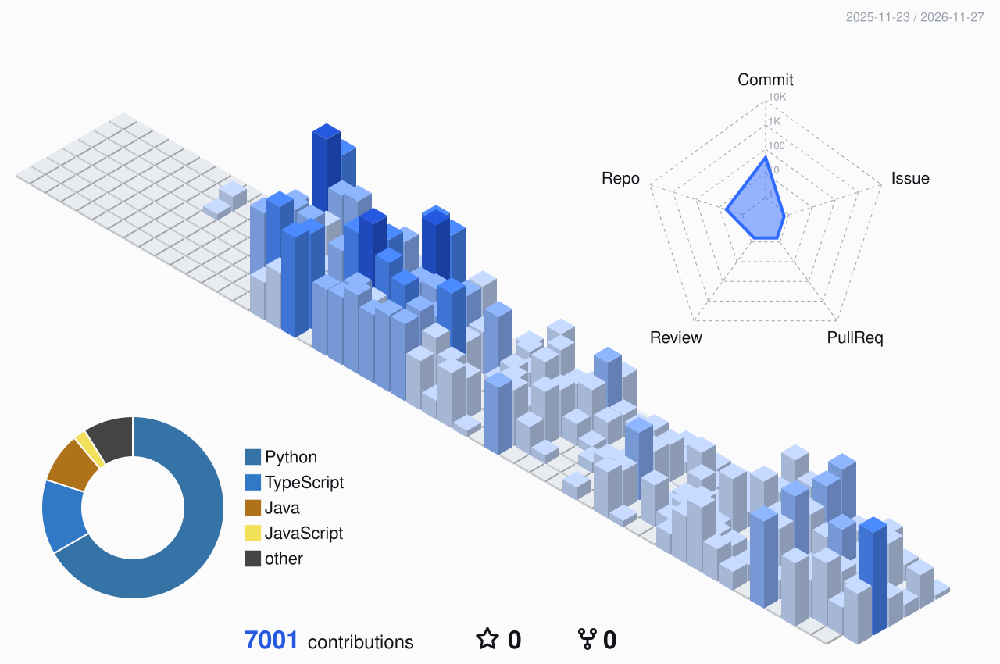

<picture>
  <source media="(prefers-color-scheme: dark)" srcset="./assets/hero-dark.svg">
  
</picture>

  
  
  
  
  

  Senior software engineer with 10+ years designing distributed systems in <b>Java and Spring</b>: microservices, event-driven architectures with <b>Kafka</b>, 
  large-scale batch processing and cloud services on <b>AWS</b> for fintech, healthcare and real estate. I bring that same engineering discipline to AI: 
  <b>RAG engines, agent workflows and WhatsApp automation</b> running in production for logistics, medical wellness and education.

  <a href="#-work-with-me"><b>Work with me</b></a> ·
  <a href="#%EF%B8%8F-stack"><b>Stack</b></a> ·
  <a href="#-play-ship-it"><b>Play</b></a> ·
  <a href="#-activity"><b>Activity</b></a>

## 🤝 Work with me

<picture>
  <source media="(prefers-color-scheme: dark)" srcset="./assets/workwithme-dark.svg">
  
</picture>

  
  

## 🛠️ Stack

<a href="https://jaxonjma.github.io/jaxonjma/">
  <picture>
    <source media="(prefers-color-scheme: dark)" srcset="./assets/orbit-dark.svg">
    
  </picture>
</a>

  <a href="https://jaxonjma.github.io/jaxonjma/"><b>✨ Explore it interactively →</b></a> 
  Click the constellation or this link: hover any technology to see where it ran in production and what it was combined with.

<b>Full skill list</b>

 

| Area | Skills |
|---|---|
| **Backend** | Java, Spring Boot, Spring WebFlux, Spring Batch, Spring Security, Spring Data JPA, Hibernate, Python, FastAPI, Node.js, REST API design, GraphQL, SOAP, async job queues |
| **Architecture** | Microservices, event-driven architecture, distributed and reactive systems, multi-tenant SaaS, API Gateway, batch processing, caching strategies, idempotency, legacy migration |
| **Data** | PostgreSQL, Supabase, row-level security, MySQL, Oracle, DynamoDB, MongoDB, Firebase, Redis, Kafka |
| **AI & agents** | LLM integration, RAG, agentic workflows, multi-agent orchestration, agent state machines, human in the loop, embeddings, pgvector, retrieval pipelines, citation grounding, LLM guardrails, speech to text (Whisper) |
| **Cloud & DevOps** | AWS (incl. Lambda), Docker, Kubernetes, CI/CD, Jenkins, GitHub, Bitbucket, Railway, Vercel, Linux, shell scripting |
| **Frontend** | React, Next.js, Angular, AngularJS, TypeScript, JavaScript, TanStack Query, HTML, CSS |
| **Integrations** | MuleSoft (Anypoint), WhatsApp Cloud API, 360dialog, Twilio, WebRTC, Stripe, Whop |

## 🎮 Play: Ship it!

<a href="https://jaxonjma.github.io/jaxonjma/play/">
  <picture>
    <source media="(prefers-color-scheme: dark)" srcset="./assets/gamecard-dark.svg">
    
  </picture>
</a>

## 📈 Activity

  <picture>
    <source media="(prefers-color-scheme: dark)" srcset="./generated/languages-dark.svg">
    
  </picture>
  <picture>
    <source media="(prefers-color-scheme: dark)" srcset="./generated/stats-dark.svg">
    
  </picture>

  

<picture>
  <source media="(prefers-color-scheme: dark)" srcset="https://raw.githubusercontent.com/jaxonjma/jaxonjma/output/snake-dark.svg">
  
</picture>

<picture>
  <source media="(prefers-color-scheme: dark)" srcset="./assets/footer-dark.svg">
  
</picture>
