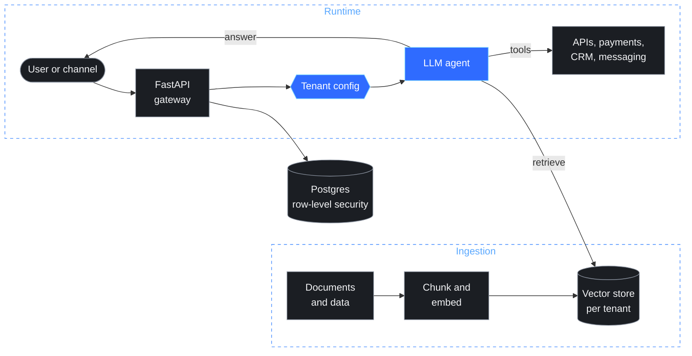

<picture>
  <source media="(prefers-color-scheme: dark)" srcset="./assets/hero-dark.svg">
  
</picture>

<p align="center">
  <a href="https://www.linkedin.com/in/jaxon-julian-munoz-avendano/"></a>
  <a href="mailto:jaxonma@gmail.com"></a>
  <a href="https://stackoverflow.com/users/5870012/jaxonjma"></a>
  
  
</p>

<p align="center">
  I build backend systems where correctness is not optional (investment cores, regulated reporting, payments,<br>
  national-scale event pipelines, telemedicine) and, increasingly, the AI layer on top of them: RAG, LLM agents and automation.
</p>

<picture>
  <source media="(prefers-color-scheme: dark)" srcset="./assets/impact-dark.svg">
  
</picture>

## 💼 Experience

<picture>
  <source media="(prefers-color-scheme: dark)" srcset="./assets/experience-dark.svg">
  
</picture>

<details>
<summary><b>Plain-text version</b> (searchable, copy-friendly)</summary>
<br>

**Independent · Freelance**, Software Engineer & AI Engineer *(now)*
- Designs and builds new Java backend features for a Colombian fintech.
- Builds multi-tenant RAG engines and LLM agents with FastAPI and Supabase (row-level security).
- Integrates payment gateways (Stripe, Whop and others): transactions, idempotency, encryption of sensitive data.
- Connects products to the WhatsApp Cloud API for conversational flows.

**EPAM · CoreLogic**, Senior Software Engineer
- Reactive microservices on Kafka segmenting real-estate leads across ~1.5M U.S. properties.
- Mortgage and property module with Java/Spring and Angular.
- GraphQL APIs on AWS, event-driven architecture.

**Makers Solutions**, Tech Lead → Software Architect
- Investment core for Protección: derivatives valuation and regulatory reporting to the Colombian Financial Superintendence.
- Bancolombia: defined caching strategies; system design, batch processing, PR review and team leadership.

**Unosquare**, Senior Java Developer
- WebRTC telemedicine with Twilio, up to 50 participants per session.
- Healthcare microservices and GraphQL services.

**Apple · FNB Ads**
- Migrations to AWS and related cloud work for the FNB Ads team.

</details>

## 🧠 AI engineering

How I build retrieval-augmented, agentic systems: one codebase, many tenants, behavior driven by configuration.



<table>
  <tr>
    <td width="33%" valign="top"><b>🔎 Retrieval</b><br>RAG pipelines with tenant-isolated knowledge, so each client's data stays theirs.</td>
    <td width="33%" valign="top"><b>🛠️ Agents</b><br>LLM agents with tool calling over real systems: payments, CRMs, messaging channels.</td>
    <td width="33%" valign="top"><b>⚙️ Config over code</b><br>New tenants and behaviors through configuration, not forks.</td>
  </tr>
</table>

## 🛠️ Stack

<picture>
  <source media="(prefers-color-scheme: dark)" srcset="./assets/orbit-dark.svg">
  
</picture>

<p align="center">
  
</p>

## 📐 How I work

```yaml
correctness:   idempotent by default, explicit failure modes, tests that describe behavior
architecture:  design for the second tenant, so the hundredth costs less than the first
data:          sensitive data encrypted, access scoped (row-level security), nothing leaks across tenants
leadership:    clear designs, honest PR reviews, teams that can run the system without me
docs:          if it only lives in my head, it isn't done
```

## 🎓 Learning

- **Diploma in Artificial Intelligence**, Universidad de los Llanos
- **Master's degree**, starting now

## 📈 Activity

<p align="center">
  
</p>

<picture>
  <source media="(prefers-color-scheme: dark)" srcset="https://raw.githubusercontent.com/jaxonjma/jaxonjma/output/snake-dark.svg">
  
</picture>

<picture>
  <source media="(prefers-color-scheme: dark)" srcset="./assets/footer-dark.svg">
  
</picture>
