<picture>
  <source media="(prefers-color-scheme: dark)" srcset="./assets/hero-dark.svg">
  
</picture>

  
  
  
  
  

  Software engineer since 2014, designing distributed systems in <b>Java and Spring</b>: microservices, event-driven architectures with <b>Kafka</b>, 
  large-scale batch processing and cloud services on <b>AWS</b> for fintech, healthcare and real estate. I bring that same engineering discipline to AI: 
  <b>RAG engines, agent workflows and WhatsApp automation</b> running in production for logistics, medical wellness and education.

  <a href="#-experience"><b>Experience</b></a> ·
  <a href="#-ai-in-production"><b>AI in production</b></a> ·
  <a href="#%EF%B8%8F-stack"><b>Stack</b></a> ·
  <a href="#-activity"><b>Activity</b></a> ·
  <a href="#-how-i-work"><b>How I work</b></a> ·
  <a href="#-education--beyond"><b>Education</b></a>

## 💼 Experience

<picture>
  <source media="(prefers-color-scheme: dark)" srcset="./assets/journey-dark.svg">
  
</picture>

<b>Plain-text version</b> (searchable, copy-friendly)

 

**2025 — now · Senior Software & AI Product Engineer** · independent, LatAm clients
- *Freight logistics:* AI agent that automates freight service assignment, picking drivers by performance score and contacting them over WhatsApp, which removes dispatcher bias. Real-time GPS monitoring with push and WhatsApp status, digital freight completion. Led the design and migration from PHP/Laravel and Angular monoliths to AWS microservices.
- *Medical wellness:* backend, back-office and client portal on a multi-tenant RAG engine (tenant isolation by API key, citation-grounded answers above a relevance threshold). Multi-turn AI sales agent driven by a state machine, with a playbook mined from voice notes transcribed with Whisper. 6 document templates pre-filled by AI and signed by a licensed professional.
- *Multi-brand ecosystem:* backend behind 4 products (subscriptions, trading education, travel, investments); legacy projects unified into one platform; shared AI layer with RAG knowledge engine, CRM engine and AI coaching agents.
- *Fintech:* Java and Spring backend features; Stripe and Whop integrations with idempotent transactions and encryption at rest.

**2022 — 2025 · Senior Software Engineer / Senior Java Developer** · U.S. clients, real estate and healthcare
- Reactive microservices with Kafka and Spring WebFlux segmenting real-estate leads across ~1.5M U.S. properties.
- Mortgage management and property history module exposed through REST and GraphQL.
- Doctor-patient WebRTC video calls (Twilio) with virtual waiting room, real-time status, up to 50 participants and screen recording; microservices for oncology patient reports.

**2018 — 2022 · Senior Developer Analyst → Technical Leader → Software Architect** · investments and banking
- Microservices for daily valuation and control of investment statements in national and international markets; nightly support for valuation and accounting closings.
- Led onboarding, technical hiring and unblocking; owned deployments, hotfixes and production incidents; massive report generation for investment funds.
- Integrated investment valuation and accounting closing through MuleSoft Anypoint as iPaaS; caching strategies, GitHub baselines, PR reviews across teams; batch processing for massive accounting files.

**2014 — 2018 · Java Developer → Developer Analyst & Technical Leader**
- Inventory and invoicing system, MySQL design and legacy data migration; laboratory process monitoring and result notifications; 200+ robots on AS400 and an internal platform, leading and training the team.

## 🧠 AI in production

<picture>
  <source media="(prefers-color-scheme: dark)" srcset="./assets/ai-dark.svg">
  
</picture>

## 🛠️ Stack

<a href="https://jaxonjma.github.io/jaxonjma/">
  <picture>
    <source media="(prefers-color-scheme: dark)" srcset="./assets/orbit-dark.svg">
    
  </picture>
</a>

  <a href="https://jaxonjma.github.io/jaxonjma/"><b>✨ Explore it interactively →</b></a> 
  Click the constellation or this link: hover any technology to see where it ran in production and what it was combined with.

<b>Full skill list</b>

 

| Area | Skills |
|---|---|
| **Backend** | Java, Spring Boot, Spring WebFlux, Spring Batch, Spring Security, Spring Data JPA, Hibernate, Python, FastAPI, Node.js, REST API design, GraphQL, SOAP, async job queues |
| **Architecture** | Microservices, event-driven architecture, distributed and reactive systems, multi-tenant SaaS, API Gateway, batch processing, caching strategies, idempotency, legacy migration |
| **Data** | PostgreSQL, Supabase, row-level security, MySQL, Oracle, DynamoDB, MongoDB, Firebase, Redis, Kafka |
| **AI & agents** | LLM integration, RAG, agentic workflows, multi-agent orchestration, agent state machines, human in the loop, embeddings, pgvector, retrieval pipelines, citation grounding, LLM guardrails, speech to text (Whisper) |
| **Cloud & DevOps** | AWS (incl. Lambda), Docker, Kubernetes, CI/CD, Jenkins, GitHub, Bitbucket, Railway, Vercel, Linux, shell scripting |
| **Frontend** | React, Next.js, Angular, AngularJS, TypeScript, JavaScript, TanStack Query, HTML, CSS |
| **Integrations** | MuleSoft (Anypoint), WhatsApp Cloud API, 360dialog, Twilio, WebRTC, Stripe, Whop |

## 📈 Activity

  <picture>
    <source media="(prefers-color-scheme: dark)" srcset="./generated/languages-dark.svg">
    
  </picture>
  <picture>
    <source media="(prefers-color-scheme: dark)" srcset="./generated/stats-dark.svg">
    
  </picture>

  

<picture>
  <source media="(prefers-color-scheme: dark)" srcset="https://raw.githubusercontent.com/jaxonjma/jaxonjma/output/snake-dark.svg">
  
</picture>

## 📐 How I work

<picture>
  <source media="(prefers-color-scheme: dark)" srcset="./assets/ways-dark.svg">
  
</picture>

## 🎓 Education & beyond

<picture>
  <source media="(prefers-color-scheme: dark)" srcset="./assets/learning-dark.svg">
  
</picture>

<picture>
  <source media="(prefers-color-scheme: dark)" srcset="./assets/footer-dark.svg">
  
</picture>
