<picture>
  <source media="(prefers-color-scheme: dark)" srcset="./assets/header-dark.svg">
  
</picture>

  
  
  
  
  

I design and ship backend systems that have to be right: financial cores, regulated reporting, event-driven pipelines at national scale, and, lately, multi-tenant AI platforms. **10+ years** across Java/Spring and Python/FastAPI, from technical lead to architecture, with a bias for code that is tested, documented and boring to operate.

Today I lead **[WildCore Labs](https://wildcorelabs.io)**, an engineering studio where we build AI-native, multi-tenant products end to end.

---

### ⚡ Selected work

| Where | What I did |
|---|---|
| **Apple** · FNB Ads | Worked on migrations to **AWS** for the FNB Ads team. |
| **EPAM** · CoreLogic | Built a **reactive microservices** system on **Kafka** to segment real-estate leads across **~1.5M U.S. properties**; **GraphQL** APIs for the real-estate domain. |
| **Unosquare** · Healthcare | Senior backend engineer on **GraphQL** services for a healthcare platform. |
| **Makers Solutions** · Protección | Investment core: **derivatives valuation** and **regulatory reporting** to the Colombian Financial Superintendence. |
| **Makers Solutions** · Bancolombia | Grew from **tech lead** to **junior architect**; defined **caching strategies** with the team. |
| **Freelance** · Colombian fintech | Designed and built new **Java** backend features. |
| **Payments** | **Stripe**, **Whop** and other gateways: transactions, **idempotency**, encryption of sensitive data. |

### 🧭 What I'm building now

**Founder & technical lead at WildCore Labs.** We take products from idea to production: software engineering end to end (design, development, testing, documentation, DevOps, cloud), AI agents and workflow automation, and full teams for companies that need one.

- 🧩 **Multi-tenant AI infrastructure**: RAG engines, LLM agents, messaging platforms, built once and configured per client (*config over code*).
- 🏗️ **Default stack**: Python/FastAPI · Supabase/Postgres · Railway. I adapt to the client's stack when it makes sense.
- 🎓 **Learning**: Diploma in Artificial Intelligence (Universidad de los Llanos), now starting a master's degree.

---

### 🛠️ Stack

<table>
  <tr>
    <td width="150"><b>Backend</b></td>
    <td></td>
  </tr>
  <tr>
    <td><b>Frontend</b></td>
    <td></td>
  </tr>
  <tr>
    <td><b>Data &amp; streaming</b></td>
    <td></td>
  </tr>
  <tr>
    <td><b>Cloud &amp; DevOps</b></td>
    <td></td>
  </tr>
  <tr>
    <td><b>AI</b></td>
    <td>RAG · LLM agents · tool calling · multi-tenant AI platforms · workflow automation</td>
  </tr>
</table>

### 📐 How I work

- **Correctness first.** Idempotent operations, explicit failure modes, tests that describe behavior.
- **Design for the second tenant.** Configuration over code, so the hundredth client costs less than the first.
- **Leave it documented.** If it only lives in my head, it isn't done.

---

  Building from Medellín, Colombia 🇨🇴 · open to remote collaboration and senior backend / AI architecture roles

