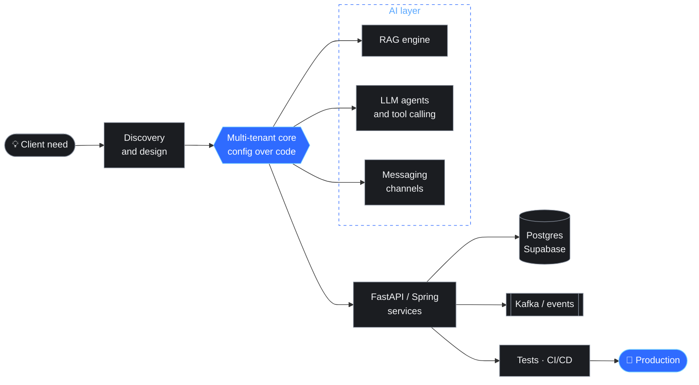

<picture>
  <source media="(prefers-color-scheme: dark)" srcset="./assets/terminal-dark.svg">
  
</picture>

<p align="center">
  <a href="https://www.linkedin.com/in/jaxon-julian-munoz-avendano/"></a>
  <a href="mailto:jaxonma@gmail.com"></a>
  <a href="https://wildcorelabs.io"></a>
  <a href="https://stackoverflow.com/users/5870012/jaxonjma"></a>
  
</p>

> **TL;DR:** 10+ years shipping backend systems where correctness matters (finance, regulated reporting, national-scale event pipelines). Now founder of **[WildCore Labs](https://wildcorelabs.io)**, building multi-tenant AI infrastructure. Open to senior backend and AI architecture roles.

---

### `$ tree ~/how-i-ship`

How a product moves through my hands, from a fuzzy idea to something you can operate at 3 a.m.:



---

### `$ man jaxon`

<details>
<summary><b>💼 Experience</b>: Apple, EPAM, Unosquare, Makers Solutions, freelance</summary>
<br>

| Company · client | Highlights |
|---|---|
| **Apple** · FNB Ads | Migrations to **AWS**. |
| **EPAM** · CoreLogic | **Reactive microservices on Kafka** for real-estate lead segmentation across **~1.5M U.S. properties**; **GraphQL** APIs. |
| **Unosquare** · Healthcare | Senior backend on **GraphQL** services. |
| **Makers Solutions** · Protección | Investment core: **derivatives valuation** and **regulatory reporting** to the Financial Superintendence. |
| **Makers Solutions** · Bancolombia | **Tech lead → junior architect**; defined **caching strategies**. |
| **Freelance** | **Java** backend features for a Colombian fintech; **Stripe/Whop** payments with idempotency and encryption. |

</details>

<details>
<summary><b>🏢 WildCore Labs</b>: what the studio does</summary>
<br>

*Wild at heart, free by design.* An engineering studio from Medellín:

- **Software engineering end to end**: web and mobile, design, development, testing, documentation, DevOps, cloud.
- **AI agents and automation** for internal processes: docs, reviews, development, marketing, sales.
- **Multi-tenant platforms**: RAG engines, LLM agents and messaging infrastructure, configured per client.
- **Teams**: full IT teams and staff augmentation for companies of any size.
- **Launch and growth**: payments, CRM, funnels, distribution and partnerships.

→ [wildcorelabs.io](https://wildcorelabs.io)

</details>

<details>
<summary><b>🛠️ Stack</b>: what I reach for</summary>
<br>

| Layer | Tools |
|---|---|
| Backend |  |
| Frontend |  |
| Data &amp; streaming |  |
| Cloud &amp; DevOps |  |
| AI | RAG · LLM agents · tool calling · workflow automation |

</details>

<details>
<summary><b>📐 Principles</b>: how I make decisions</summary>
<br>

```yaml
correctness: idempotent by default, explicit failure modes, tests that describe behavior
scale:       design for the second tenant, so the hundredth costs less than the first
stack:       adapt to the client's; default to Python/FastAPI · Supabase · Railway
docs:        if it only lives in my head, it isn't done
```

</details>

<details>
<summary><b>🎓 Learning</b></summary>
<br>

- Diploma in Artificial Intelligence, Universidad de los Llanos.
- Starting a master's degree.

</details>

---

### `$ git log --graph`

<picture>
  <source media="(prefers-color-scheme: dark)" srcset="https://raw.githubusercontent.com/jaxonjma/jaxonjma/output/snake-dark.svg">
  
</picture>

<p align="center"><sub>Medellín, Colombia 🇨🇴 · <code>exit 0</code></sub></p>
