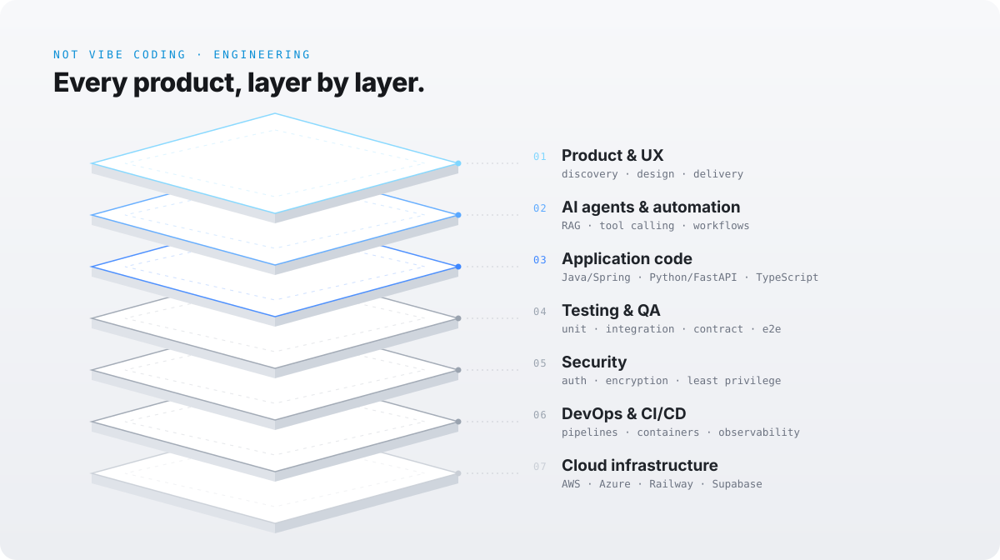

<a href="https://wildcorelabs.io">
  <picture>
    <source media="(prefers-color-scheme: dark)" srcset="./assets/wcl-banner-dark.svg">
    
  </picture>
</a>

<h3 align="center">Hi, I'm Jaxon, founder &amp; technical lead of WildCore Labs.</h3>

  Senior software engineer (10+ years) turned studio founder. We build software the way it should be built: 
  engineered in layers, tested, documented and ready for production. Then we help you put it in front of people.

  
  
  
  

---

### What we build

<table>
  <tr>
    <td width="33%" valign="top">
      <h4>🏗️ Software engineering</h4>
      Web and mobile products end to end: architecture, development, testing, documentation, DevOps and cloud.
    </td>
    <td width="33%" valign="top">
      <h4>🤖 AI agents &amp; automation</h4>
      Agents and workflows for internal processes: docs, reviews, development, marketing and sales.
    </td>
    <td width="33%" valign="top">
      <h4>🧩 Multi-tenant platforms</h4>
      RAG engines, LLM agents and messaging infrastructure, built once and configured per client.
    </td>
  </tr>
  <tr>
    <td valign="top">
      <h4>👥 Teams &amp; consulting</h4>
      A full IT team or staff augmentation, for companies of any size. Architecture and technical consulting.
    </td>
    <td valign="top">
      <h4>🚀 Launch &amp; growth</h4>
      Payments, CRM, funnels, distribution and partnerships: what it takes to get the product used.
    </td>
    <td valign="top">
      <h4>🎮 Games for brands</h4>
      Playable experiences and entertainment built around your brand and your services.
    </td>
  </tr>
</table>

 

<picture>
  <source media="(prefers-color-scheme: dark)" srcset="./assets/layers-dark.svg">
  
</picture>

---

### Behind the studio

Before WildCore Labs I spent a decade building systems where mistakes are expensive:

- **Apple** · FNB Ads: migrations to AWS.
- **EPAM** · CoreLogic: reactive Kafka microservices segmenting leads across ~1.5M U.S. properties; GraphQL for real estate.
- **Unosquare**: GraphQL services for a healthcare platform.
- **Makers Solutions**: investment core for Protección (derivatives valuation, regulatory reporting), then Bancolombia, from tech lead to junior architect.
- **Freelance**: Java backend for a Colombian fintech; payment integrations (Stripe, Whop) with idempotency and encryption.

🎓 Diploma in Artificial Intelligence, Universidad de los Llanos · starting a master's degree.

### How we work

| | |
|---|---|
| ⚙️ **Config over code** | Built for the second client from day one, so the next one costs less. |
| 🔌 **Your stack, not ours** | We adapt to what you already run. Our default: Python/FastAPI · Supabase · Railway. |
| ⏱️ **Minutes, not days** | We answer fast and ship in small, visible steps. |

  

---

  <b>Have something to build?</b> 
  <a href="https://wildcorelabs.io">wildcorelabs.io</a> · Medellín, Colombia 🇨🇴 · open to remote collaboration

